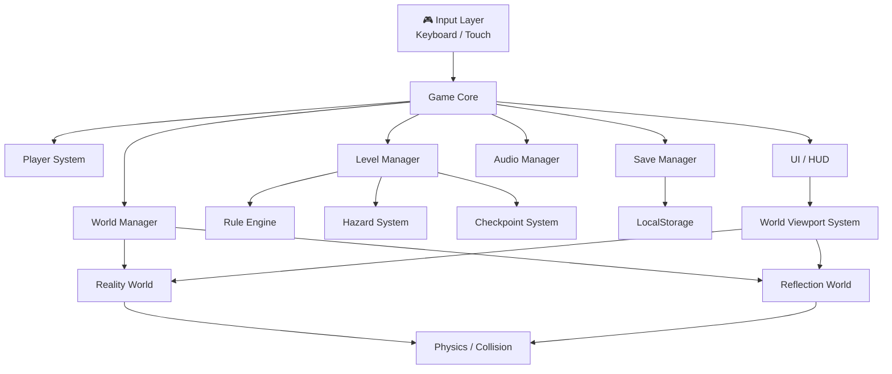
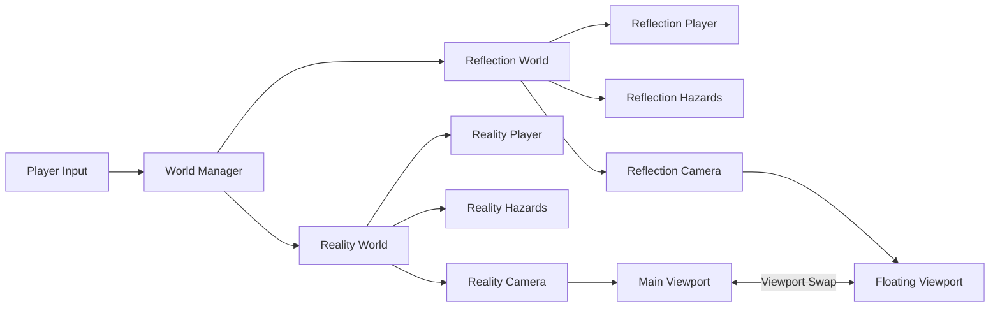
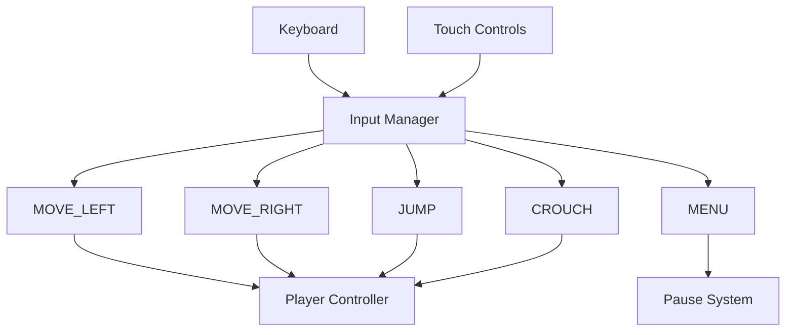
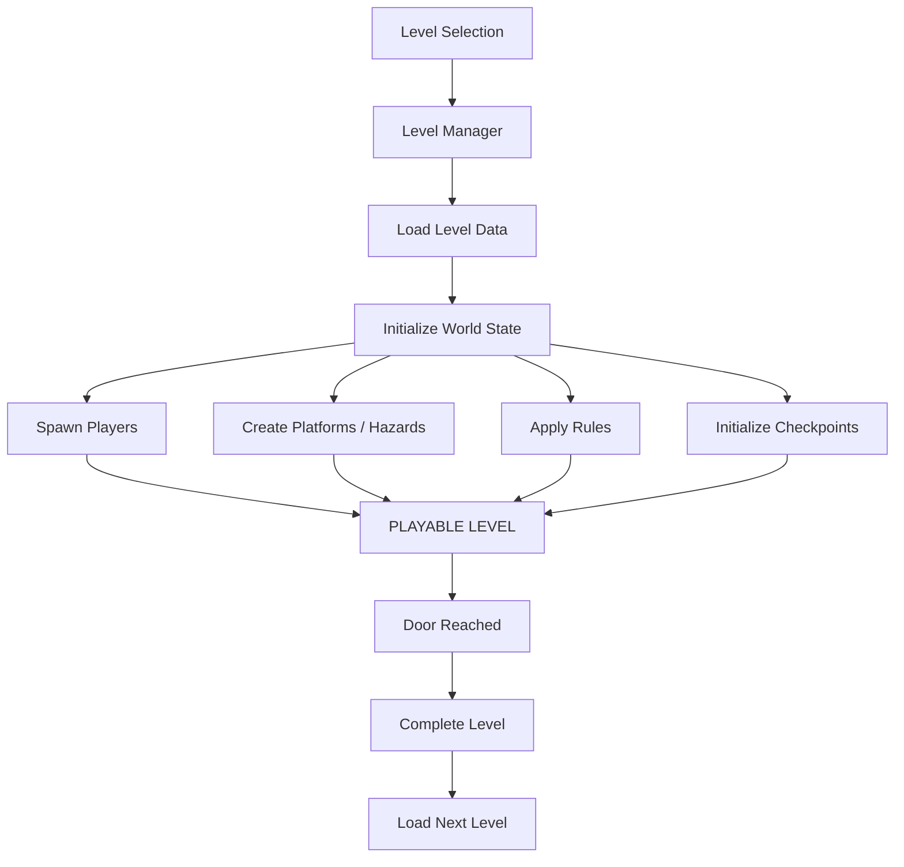
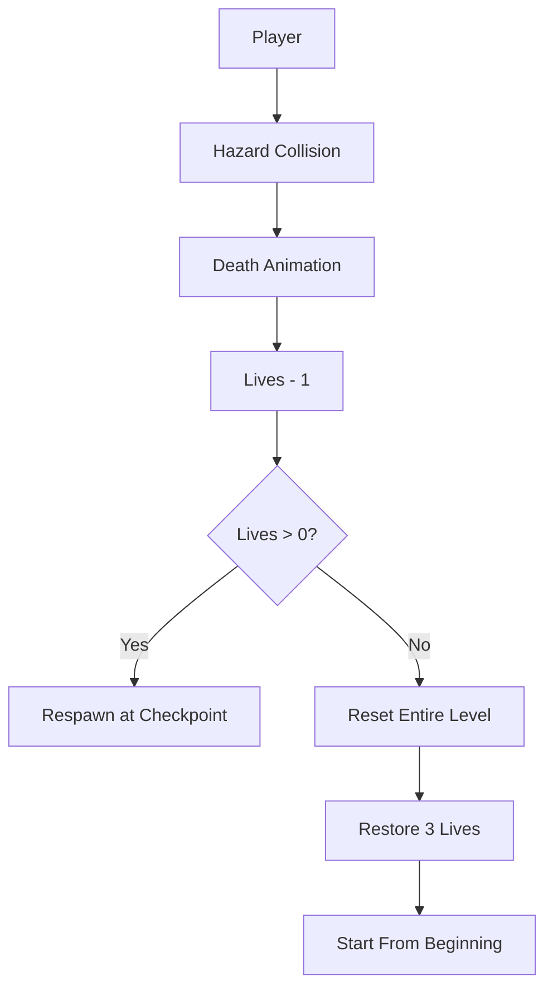
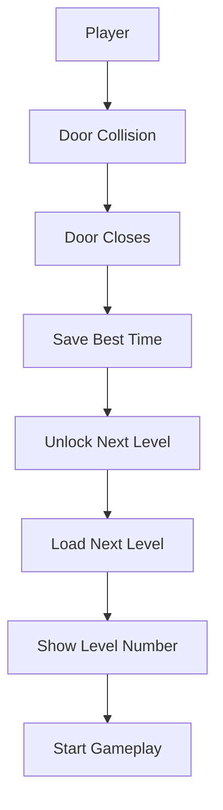
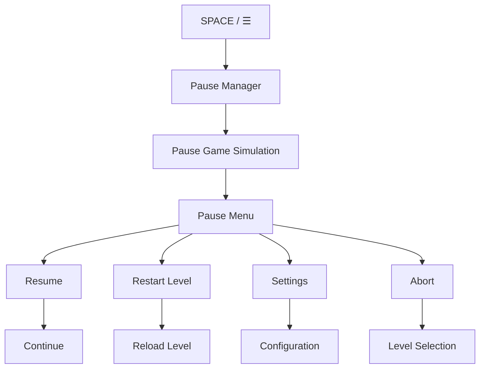
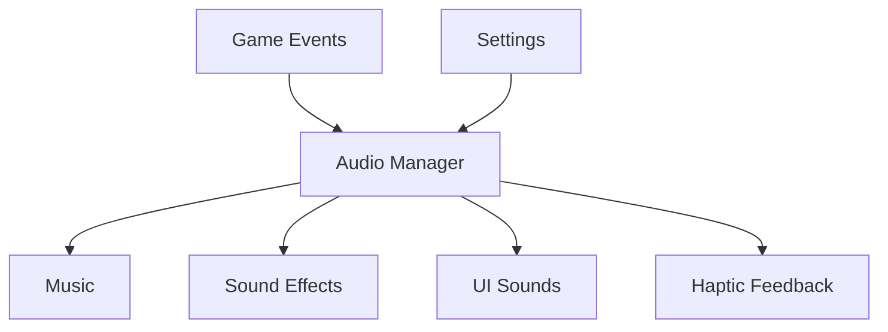
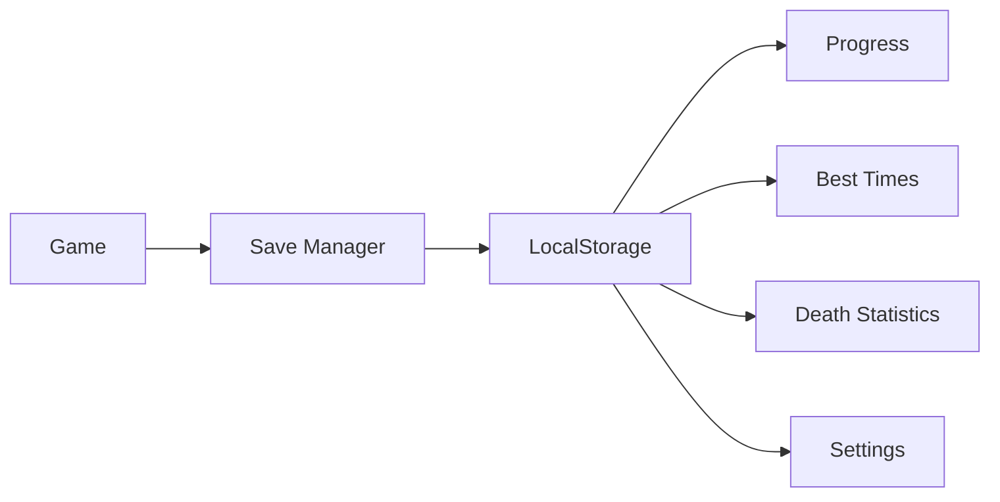
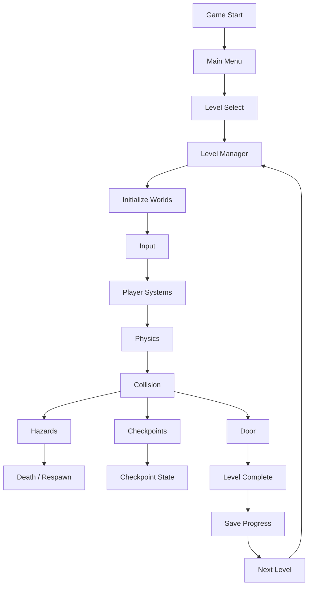

# 🪞 Reflection — Architecture

> Technical architecture for the Reflection web game MVP.

---

## 1. System Overview



---

## 2. Core Architecture

Reflection uses a **data-driven game architecture**.

```text
                    ┌─────────────────┐
                    │    GAME CORE    │
                    └────────┬────────┘
                             │
        ┌────────────┬───────┼────────┬─────────────┐
        ↓            ↓       ↓        ↓             ↓
     INPUT         WORLD    LEVEL    PLAYER         UI
        │            │       │        │             │
        ↓            ↓       ↓        ↓             ↓
    Keyboard /   Reality / Rules / Physics      HUD / Menu
    Touch        Reflection  Hazards
                              │
                              ↓
                         Checkpoints
                              │
                              ↓
                           Save Data
```

---

# 3. Two-World Architecture

The defining mechanic of Reflection is that **Reality and Reflection are separate, simultaneously simulated worlds**.



### Important rule

The floating world is **not paused**.

Both worlds continue running:

```text
Reality      → SIMULATING
Reflection   → SIMULATING
```

The viewport only determines which world receives the larger visual presentation.

---

# 4. World State

Each world maintains its own state.

```text
World
├── Player
├── Platforms
├── Hazards
├── Dynamic Objects
├── Environment
├── Physics State
├── Active Rules
└── Camera
```

Conceptually:

```ts
WorldState {
  player
  objects[]
  hazards[]
  platforms[]
  rules
  camera
  physics
}
```

Reality and Reflection share the same level definition but may have different runtime states and rules.

---

# 5. Viewport System

The viewport system controls how the two worlds are presented.

```text
                  WORLD MANAGER
                       │
             ┌─────────┴─────────┐
             ↓                   ↓
          REALITY            REFLECTION
             │                   │
          Camera              Camera
             │                   │
             ↓                   ↓
       ┌────────────┐      ┌────────────┐
       │    MAIN    │      │  FLOATING  │
       │  VIEWPORT  │      │  VIEWPORT  │
       └────────────┘      └────────────┘
```

Initial state:

```text
MAIN     = Reality
FLOATING = Reflection
```

After clicking/tapping the floating viewport:

```text
MAIN     = Reflection
FLOATING = Reality
```

The swap changes **presentation**, not simulation.

---

# 6. Input Architecture

Keyboard and touch controls use the same abstraction.



### Desktop

```text
A / ←       MOVE_LEFT
D / →       MOVE_RIGHT
W / ↑       JUMP
S / ↓       CROUCH
SPACE       MENU
```

### Mobile

```text
◀           MOVE_LEFT
▶           MOVE_RIGHT
▲           JUMP
▼           CROUCH
☰           MENU
```

Gameplay code must never depend directly on keyboard keys or touch events.

---

# 7. Player Architecture

```text
Player
├── Input
├── Movement
├── Jump
├── Crouch
├── Physics
├── Collision
├── Animation
├── Death
└── Respawn
```

Both worlds contain a player instance.

```text
Reality Player
       │
       ├── receives same player input
       └── uses Reality rules

Reflection Player
       │
       ├── receives same player input
       └── uses Reflection rules
```

This allows the same action to produce different outcomes.

---

# 8. Rule Engine

Level mechanics should be **data-driven**.

Instead of hard-coding behavior into individual levels:

```text
Level Data
     │
     ↓
Rule Engine
     │
 ┌───┼──────────────┐
 ↓   ↓              ↓
Movement Gravity    Wind
 ↓   ↓              ↓
Physics / Player / Objects
```

Possible rules:

```text
invertedMovement
invertedGravity
invertedWind
modifiedFriction
modifiedMomentum
modifiedTime
lightBehavior
hazardBehavior
objectBehavior
```

Example:

```ts
rules: {
  invertedMovement: true,
  invertedGravity: true,
  invertedWind: false
}
```

Adding a new rule should not require rewriting existing levels.

---

# 9. Level Architecture

Levels are configuration-driven.

```text
Level
├── Metadata
├── World Rules
├── Player Spawn
├── Door
├── Checkpoints
├── Platforms
├── Hazards
└── Dynamic Objects
```

Example:

```ts
{
  id: 7,
  world: 2,

  rules: {
    invertedMovement: true,
    invertedGravity: true,
    invertedWind: false
  },

  playerSpawn: {...},

  checkpoints: [...],

  door: {...},

  platforms: [...],

  hazards: [...]
}
```

The `LevelManager` loads the configuration and creates the required runtime objects.

---

# 10. Level Manager



---

# 11. Checkpoint System

Checkpoints are automatic.

```text
Player
   │
   ↓
Cross Checkpoint
   │
   ↓
CheckpointManager
   │
   ↓
currentCheckpoint = checkpoint_X
```

On death:

```text
Death
  ↓
Lives - 1
  ↓
Restore checkpoint state
  ↓
Respawn player
```

On third death:

```text
Death
  ↓
Lives = 0
  ↓
Reset entire level
  ↓
Lives = 3
  ↓
Checkpoint = START
  ↓
Restart
```

---

# 12. Hazard Architecture

Hazards should be reusable components.

```text
Hazard
├── Collision
├── Movement
├── Damage / Death
├── Animation
└── Rule Response
```

MVP hazards:

```text
Spikes
Rolling Blades
Crushers
Lasers
Moving Platforms
Falling Platforms
Disappearing Platforms
```

A hazard may behave differently in each world.

```text
             Hazard
                │
        ┌───────┴────────┐
        ↓                ↓
     Reality         Reflection
        │                │
     Normal          Inverted
     Behavior        Behavior
```

---

# 13. Death & Life Flow



Death animation should be extremely short.

The avatar visually collapses/reduces into a dot.

Avoid a traditional game-over screen.

---

# 14. Door / Completion Flow



The player does not manually select "Next Level".

---

# 15. Timer System

```text
LEVEL START
     │
     ↓
 TIMER RUNNING
     │
     ├──── Pause → TIMER PAUSED
     │                  │
     │               Resume
     │                  │
     │                  ↓
     └──────────── TIMER RUNNING
                         │
                    Door Reached
                         │
                         ↓
                    TIMER STOPPED
                         │
                         ↓
                   Save Best Time
```

Timer state belongs to the current level runtime and is persisted only through best-time data.

---

# 16. Pause Architecture



While paused:

```text
Physics        PAUSED
Player         PAUSED
Hazards        PAUSED
Timer          PAUSED
Audio          configurable
UI             ACTIVE
```

---

# 17. UI Architecture

```text
UI
├── Main Menu
├── Level Select
├── HUD
│   ├── Level Number
│   ├── Timer
│   └── Lives
├── Pause Menu
├── Settings
├── Mobile Controls
├── World Viewports
└── Completion Screen
```

HUD should remain minimal.

The gameplay area should be the focus.

---

# 18. Mobile UI

```text
┌──────────────────────────────────────────────┐
│ ┌──────────────┐                       ☰     │
│ │ Reflection   │                             │
│ │              │                             │
│ └──────────────┘                             │
│                                              │
│                  GAME                        │
│                                              │
│                                              │
│                                              │
│   ◀     ▶                         ▼     ▲    │
└──────────────────────────────────────────────┘
```

Controls:

```text
Bottom-left  → Left / Right
Bottom-right → Crouch / Jump
Top-right    → Menu
Top-left     → Floating world viewport
```

Controls should use safe-area-aware positioning.

Mobile buttons should be approximately **75% opaque** at rest and become more opaque when pressed.

---

# 19. Audio Architecture



Audio must respect:

```text
Music ON/OFF
SFX ON/OFF
Haptics ON/OFF
```

---

# 20. Persistence

No backend is required for MVP.



Persist:

```text
Unlocked levels
Completed levels
Best times
Death statistics
Settings
```

---

# 21. Five-World Progression

```text
WORLD 1 — MIRROR
01 02 03 04 05 06
        ↓
WORLD 2 — PHYSICS
07 08 09 10 11 12
        ↓
WORLD 3 — HAZARDS
13 14 15 16 17 18
        ↓
WORLD 4 — REALITY
19 20 21 22 23 24
        ↓
WORLD 5 — PARADOX
25 26 27 28 29 30
```

Difficulty progression:

```text
Introduce
    ↓
Demonstrate
    ↓
Challenge
    ↓
Combine
    ↓
Master
```

---

# 22. Suggested Project Structure

```text
src/
├── core/
│   ├── Game.ts
│   ├── GameLoop.ts
│   ├── InputManager.ts
│   ├── PauseManager.ts
│   └── EventBus.ts
│
├── player/
│   ├── Player.ts
│   ├── PlayerController.ts
│   ├── PlayerPhysics.ts
│   └── PlayerAnimation.ts
│
├── worlds/
│   ├── WorldManager.ts
│   ├── World.ts
│   ├── RealityWorld.ts
│   ├── ReflectionWorld.ts
│   ├── WorldRules.ts
│   └── ViewportManager.ts
│
├── levels/
│   ├── LevelManager.ts
│   ├── LevelLoader.ts
│   ├── LevelData.ts
│   └── levels/
│
├── hazards/
│   ├── Hazard.ts
│   ├── Spike.ts
│   ├── RollingBlade.ts
│   ├── Crusher.ts
│   ├── Laser.ts
│   ├── MovingPlatform.ts
│   └── FallingPlatform.ts
│
├── checkpoints/
│   ├── Checkpoint.ts
│   └── CheckpointManager.ts
│
├── systems/
│   ├── PhysicsSystem.ts
│   ├── CollisionSystem.ts
│   ├── RuleSystem.ts
│   ├── TimerSystem.ts
│   ├── LifeSystem.ts
│   └── SaveManager.ts
│
├── ui/
│   ├── MainMenu.ts
│   ├── LevelSelect.ts
│   ├── HUD.ts
│   ├── PauseMenu.ts
│   ├── SettingsMenu.ts
│   ├── MobileControls.ts
│   └── WorldViewport.ts
│
├── audio/
│   └── AudioManager.ts
│
├── data/
│   ├── levels/
│   ├── worlds/
│   └── rules/
│
├── assets/
│   ├── sprites/
│   ├── audio/
│   ├── fonts/
│   └── effects/
│
└── main.ts
```

> Adapt the exact structure to the chosen game framework. The separation of responsibilities is more important than matching this structure literally.

---

# 23. Runtime Flow



---

# 24. Core Design Principle

The architecture should separate:

```text
WHAT THE LEVEL IS
        ↓
     Level Data

WHAT THE RULES DO
        ↓
     Rule System

WHAT THE PLAYER DOES
        ↓
    Input System

HOW THE WORLD RESPONDS
        ↓
 Physics / Collision

HOW THE WORLD IS SHOWN
        ↓
  Viewport System
```

This allows new levels and mechanics to be added without rewriting core systems.

---

# 25. MVP Boundary

### IN MVP

```text
✓ 30 levels
✓ 5 worlds
✓ Reality
✓ Reflection
✓ Dual simulation
✓ Viewport swapping
✓ Movement
✓ Jump
✓ Crouch
✓ Hazards
✓ Reflection rules
✓ Checkpoints
✓ 3 lives
✓ Death / respawn
✓ Timer
✓ Door completion
✓ Automatic progression
✓ Pause menu
✓ Settings
✓ Mobile controls
✓ Desktop controls
✓ Audio
✓ Haptics
✓ Fullscreen
✓ Local persistence
```

### POST-MVP

```text
○ Online leaderboard
○ Accounts
○ Cloud saves
○ Multiplayer
○ Achievements
○ Skins
○ Additional game modes
○ Online statistics
```

---

# 26. Architecture Goal

The most important technical requirement is:

> **The game must be easy to expand without making the core systems more complicated.**

A new level should primarily require:

```text
Level Data
+
Existing Rules
+
Existing Objects
```

rather than new gameplay code.

A new hazard should be implemented once and then reusable across multiple levels.

A new Reflection rule should be implemented once and configurable per level.

---

# 27. Final Architecture Principle

```text
                    REFLECTION
                         │
             ┌───────────┴───────────┐
             │                       │
          REALITY                REFLECTION
             │                       │
             └───────────┬───────────┘
                         │
                    SHARED INPUT
                         │
                   RULE ENGINE
                         │
              ┌──────────┼──────────┐
              ↓          ↓          ↓
           PHYSICS     HAZARDS   OBJECTS
              │          │          │
              └──────────┼──────────┘
                         ↓
                   LEVEL SYSTEM
                         │
              ┌──────────┴──────────┐
              ↓                     ↓
           CHECKPOINT            DOOR
              │                     │
              ↓                     ↓
            RESPAWN            NEXT LEVEL
              │                     │
              └──────────┬──────────┘
                         ↓
                    SAVE MANAGER
                         │
                     LocalStorage
```

---

## Final Architecture Principle

**Build the core loop first. Polish second. Content third.**

The defining experience of Reflection is not the menu, effects, or number of hazards.

It is:

> **Seeing two worlds, understanding their relationship, switching between them, and surviving long enough to reach the door.**
